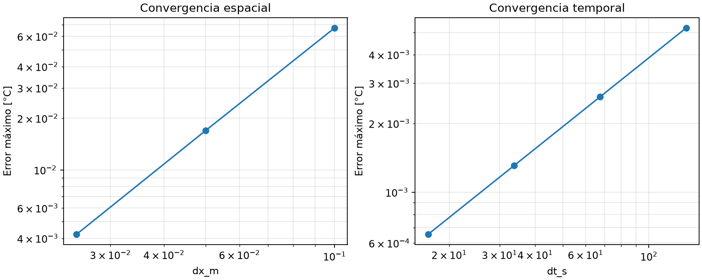
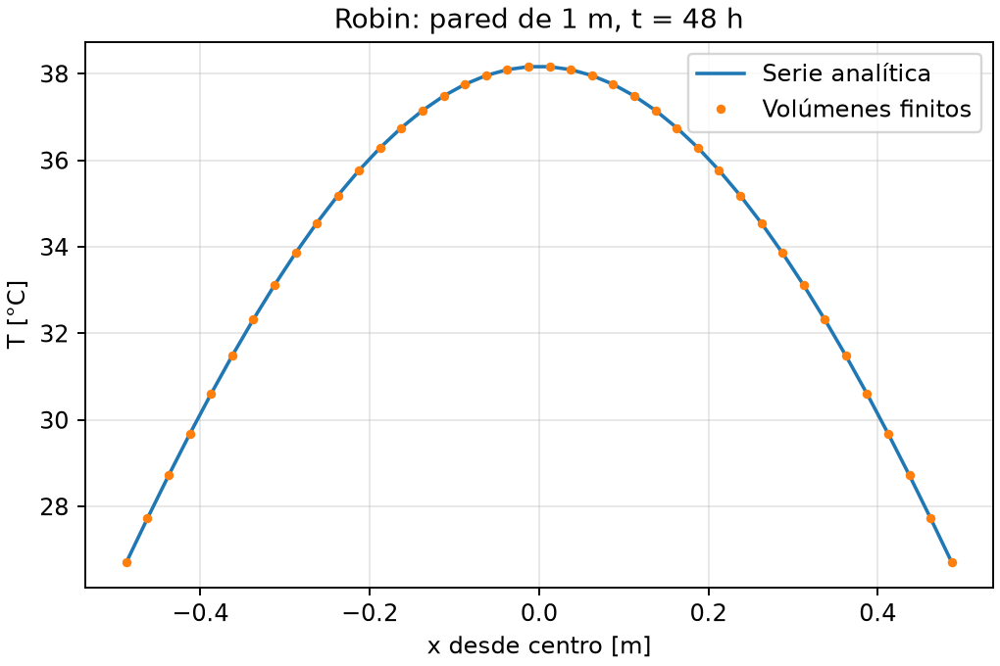
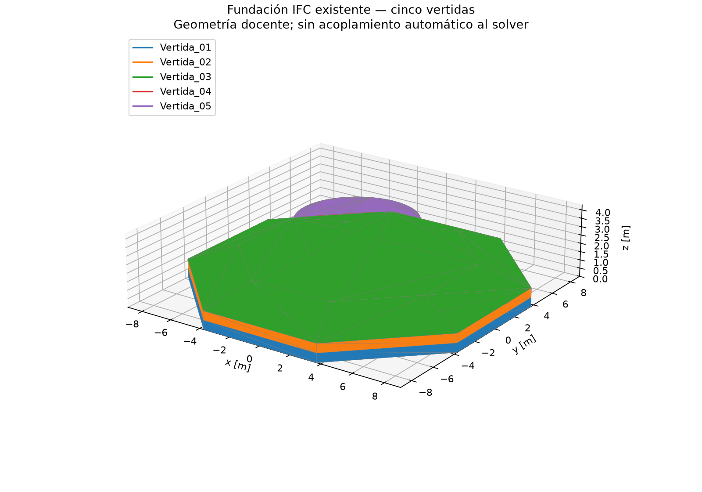

# E06 — Dossier de verificación + BIM del caso

**Entrega:** viernes 30 de octubre de 2026. **Grupo 1.**

Repositorio: <https://github.com/magdalenafr-uandes/P02-MCOC>

Commit evaluado (código, IFC, métricas y figuras):
`c9e98e1d1c93d8177ca2c3c7fb634194b85d82ff`.
Este dossier se incorpora en un commit documental posterior; las referencias
numéricas corresponden exclusivamente al SHA declarado. Debe publicarse ese
commit antes de entregar el enlace en Canvas.

## Matriz de verificación

Ejecución local: 29 de octubre de 2026, Python 3.12.10. **5/5 tests de raíz
y 83/83 del proyecto aprobados**, sin omisiones. Registro completo:
[tests.txt](evidencia_e06/tests.txt). El motor evaluado es `SolverVoxel`,
volúmenes finitos centrados y Euler explícito. El solver nodal histórico
y el adaptador ND también están cubiertos por la batería.

| Test | Qué verifica | Error/métrica | Resultado |
| ---- | ------------ | ------------- | --------- |
| Sinusoidal espacial 1D | Discretización de difusión | órdenes 1,987 y 2,007; criterio 1,8–2,2 | Cumple |
| Sinusoidal temporal 1D | Euler explícito | órdenes 1,00056–1,00014; criterio 0,95–1,05 | Cumple |
| Sinusoidal 2D/3D | Difusión multidimensional | batería exige orden 1,8–2,2 y error fino <0,05 °C | Cumple |
| Energía adiabática 3D | Cancelación de flujos internos | deriva relativa máxima 1,51×10⁻¹⁶ <10⁻¹² | Cumple |
| Fuente uniforme 3D | Unidades e integración de q | error 1,34×10⁻¹² °C <10⁻¹⁰; balance relativo 2,66×10⁻¹⁵ <10⁻¹² | Cumple |
| Robin transitorio | Convección frente a serie analítica | error máximo 0,006081 °C <0,05 °C | Cumple |
| Neumann y fuente por celda | Potencia por área y volumen | balances relativos: tolerancia 10⁻¹² en tests | Cumple |
| Interfaz de materiales | Resistencias en serie | flujo relativo <10⁻⁶ y perfil absoluto <10⁻⁵ °C en tests | Cumple |
| Superficie y estabilidad | Reconstrucción de cara y rechazo de paso | regresiones y excepciones esperadas aprobadas | Cumple |
| IFC base | Cinco vertidas, propiedades, dimensiones y volúmenes | inspección y tests geométricos aprobados | Cumple |

Las cifras medidas están en [metricas.json](evidencia_e06/metricas.json).
Las filas que citan tolerancias de tests indican criterios aprobados, no errores
medidos iguales a esas tolerancias.

## Convergencia espacial y temporal

Caso: barra de 1 m, k=2,22 W/(m·K), ρ=2400 kg/m³,
cp=970 J/(kg·K), inicio T=20+50 sin(πx), caras a 20 °C y t=21600 s.
Se usa error máximo sobre centros de celda.

| Δx [m], con Δt=1,08 s fijo | Error espacial [°C] | Orden |
| --- | ---: | ---: |
| 0,100 | 0,0671755 | — |
| 0,050 | 0,0169506 | 1,987 |
| 0,025 | 0,00421783 | 2,007 |

La referencia espacial es la solución continua
T=20+50 sin(πx) exp(−απ²t). El paso pequeño fijo reduce la contaminación temporal;
no se afirma error temporal nulo.

| Δt [s], con Δx=0,05 m fijo | Error temporal [°C] | Orden |
| --- | ---: | ---: |
| 135,000 | 0,00523807 | — |
| 67,500 | 0,00261801 | 1,00056 |
| 33,750 | 0,00130875 | 1,00028 |
| 16,875 | 0,000654311 | 1,00014 |

Para aislar tiempo se compara contra la solución semidiscreta exacta del modo:
Tₕ=20+50 sin(πx) exp(−λₕt), λₕ=4α/Δx²·sin²(π/(2n)).
Los pasos cumplen el límite del motor. El orden se calcula mediante
p=log(e₁/e₂)/log(h₁/h₂), usando h=Δx o Δt según corresponda.



## Energía, fuente y Robin

**Energía:** caja 8³, celdas de 0,1 m, campo aleatorio reproducible
(semilla 0), bordes adiabáticos y sin fuente; 500 pasos a 0,9·dt_max.
Se mide max|E(t)−E(0)|/|E(0)|, con E=ΣρcpVT. La conservación
comprueba el balance discreto, no valida un caso físico real.

**Fuente:** misma caja, inicio uniforme a 20 °C, q=1000 W/m³,
400 pasos a 0,5·dt_max. Referencia T=20+qt/(ρcp);
se comprueba además ΔE=qVt. El residuo se normaliza por qVt.

**Robin:** pared de espesor 1 m, 40×3 celdas, inicio a 60 °C,
ambiente 20 °C, h=15 W/(m²·K), caras laterales adiabáticas y t=48 h.
Se compara con la serie analítica de pared convectiva, no con un estado estacionario.
La resistencia de media celda se incluye en el flujo de cara.



## BIM base: imagen, dimensiones y simplificaciones

El [IFC4 versionado](../geometry/foundation.ifc) es la referencia geométrica.
La figura se obtiene directamente de su triangulación, sin regenerarlo.
La [inspección](evidencia_e06/inspeccion_ifc.txt) identifica cinco `IfcFooting`
por `UANDES_HormigonMasivo.VertidaID`, con unidades SI.



Base octagonal regular: **18 m entre caras opuestas**, envolvente 18×18 m.
Dos capas inferiores de 0,55 m dan 1,10 m en el borde; dos transiciones
de 1,10 m llegan a z=3,30 m. Pedestal: **Ø7 m ×1 m**, hasta z=4,30 m.

| Vertida | Envolvente [m] | Volumen [m³] |
| --- | --- | ---: |
| 01 | 18×18×0,55 | 147,63 |
| 02 | 18×18×0,55 | 147,63 |
| 03 | 18×18×1,10 | 214,22 |
| 04 | 12,5×12,5×1,10 | 88,92 |
| 05 | 7×7×1,00 | 38,37 |
| Total, sin redondear por fila | | **636,78** |

Simplificaciones geométricas explícitas:

1. Fundación idealizada simétrica, con base octagonal regular y transiciones planas.
2. Pedestal circular aproximado por polígono de 48 lados: 38,37 m³ frente
   a 38,48 m³ del cilindro (diferencia aproximada 0,29 %).
3. Cinco sólidos homogéneos por vertida; interfaces sin espesor físico.
4. Sin armaduras, pernos, ductos, huecos ni detalles de anclaje.
5. Sin excavación, terreno irregular, sobreexcavación ni tolerancias constructivas.
6. Moldajes y aislaciones no tienen geometría propia; sus campos IFC siguen `TBD`.

El BIM es una base geométrica docente. La voxelización existente es paramétrica;
no lee automáticamente el IFC ni acopla todavía su máscara irregular al solver.
No se simulan aquí hidratación realista, clima ni activación temporal de vertidas.

## Reproducción

Desde la raíz, instalar los dos entornos separados según
[README](../README.md). Luego:

```powershell
powershell -NoProfile -ExecutionPolicy Bypass -File proyecto/scripts/verificar_entregas.ps1
.\proyecto\.venv\Scripts\python.exe proyecto/scripts/dossier_e06.py
.\proyecto\.venv\Scripts\python.exe proyecto/scripts/inspect_ifc.py
.\proyecto\.venv\Scripts\python.exe proyecto/scripts/preview_foundation.py --salida proyecto/results/figures/e06_bim.png
```

El script exige las tolerancias de la matriz antes de escribir métricas.
El SHA256 del IFC se conserva en el JSON para identificar exactamente el modelo.
