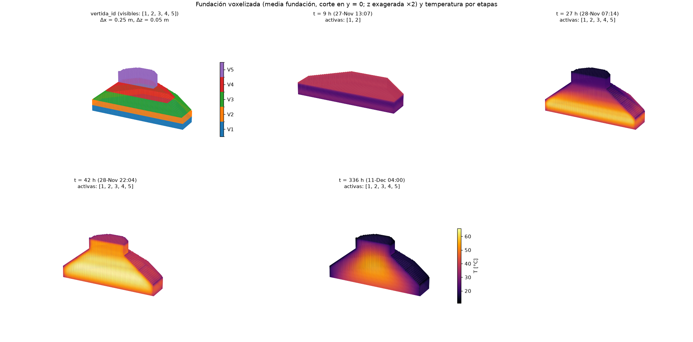

# E08 — Lab: BIM → grid y activación de vertidas

Jueves 5 de noviembre, 10:30–12:30 (3 puntos). Objetivo: demostrar el pipeline
completo desde el IFC hasta una simulación térmica por etapas, con la
secuencia en los **inputs** y no en el solver.

Detalle técnico, verificación y respuestas de E07: [e07_e08.md](e07_e08.md).

## Antes de la actividad (checklist del enunciado)

| Exigencia | Dónde | Evidencia |
|---|---|---|
| IFC | `geometry/foundation.ifc` (5 `IfcFooting`, pset `UANDES_HormigonMasivo`) | `test_ifc_cinco_vertidas_cerradas_y_volumen` |
| Extracción | `bim/mallas_ifc.py`: malla triangulada + pset por `VertidaID` | malla IFC = volumen paramétrico (1e-9) |
| Voxelización | `bim/voxelizador.py`: centro dentro por paridad de rayos; `vertida_id` | 0 solapes; `e_V` por vertida < 1 % con Δz = 0,05 |
| Visualización 3D | `--figura3d` (matplotlib, corte en y = 0) y `--vtk` (`.vti` + `.pvd` para ParaView) | `results/figures/e08_3d.png` |
| ≥ 2 vertidas con activación distinta | 5 vertidas: 0, 6, 12, 18 y 24 h (pset del IFC o YAML) | `test_activacion_por_etapas_y_caras_expuestas` |
| Hidratación funcional | `thermal/hidratacion.py`: q̇ = ρc_p·dθ/dt_e·f(T) | adiabático vs RK4; ∫q̇ dt = ρc_pθ∞ |
| Secuencia en los inputs | `configs/e07_caso_base.yaml` + `--set`; el solver no importa YAML ni IFC | `test_solver_no_lee_configuracion_ni_ifc` |

Instalar una vez (el pipeline usa PyYAML):

```powershell
cd proyecto
.venv\Scripts\python.exe -m pip install -e ".[dev]"
```

## Durante la actividad: un comando por pedido

Todos desde `proyecto/`. El **modo rápido** (`--set malla.paso_m=0.5 --set
simulacion.duracion_h=72`) corre en ~12 s. El caso completo (14 días, Δx = 0,25 m)
tarda ~100 s.

| Pedido del ayudante | Comando | Qué mirar |
|---|---|---|
| **Cambiar Δx** y **reportar error de volumen** | `.venv\Scripts\python.exe scripts\pipeline_e07.py --solo-grilla --set malla.paso_m=0.4` | tabla "Volumen (G04)": V_malla, V_h y e_V por vertida (~1 s) |
| Error de volumen con voxel cúbico | `... --solo-grilla --set malla.paso_m=0.25 --set malla.paso_z_m=0.25` | e_V por vertida de 9–16 %: 0,55 m no es múltiplo de 0,25 |
| **Ocultar una vertida** | `.venv\Scripts\python.exe scripts\comparar_e08.py --variante vertidas.5.visible=false` | la vertida 5 no se activa; ADVERTENCIA si otra quedaba apoyada en ella |
| **Mostrar** de nuevo | sin el `--set` (o `vertidas.5.visible=true`) | — |
| **Cambiar hora de inicio** | `... comparar_e08.py --variante vertidas.3.inicio_h=20` | picos y ΔT antes/después; advierte si V4 queda sin apoyo |
| Inicio con fecha-hora | `... --variante "vertidas.2.inicio=2026-11-27T14:00"` | se convierte a horas desde `simulacion.inicio` |
| **Cambiar T de colocación** | `... comparar_e08.py --variante vertidas.defecto.T_colocacion_C=10` | T_max −7 °C, ΔT −7 °C (modo rápido) |
| **Ejecutar** | `.venv\Scripts\python.exe scripts\pipeline_e07.py --set malla.paso_m=0.5 --set simulacion.duracion_h=72 --figura3d results\figures\demo_3d.png` | plan con el origen de cada dato, etapas, picos y criterios |
| **Visualizar el efecto** | la figura de `comparar_e08.py` (`results/figures/e08_comparacion.png`) | curvas base (—) vs variante (--) y corte 3D de ambas |
| Serie para ParaView | `... pipeline_e07.py --set malla.paso_m=0.5 --set simulacion.duracion_h=72 --vtk results\vtk\demo` | abrir `temperatura.pvd`; Threshold sobre `material` > 0; color por `temperatura` |

`--set` acepta cualquier clave del YAML: `vertidas.<id>.T_colocacion_C`,
`vertidas.defecto.R_superior_m2K_W`, `simulacion.inicio`, `malla.paso_z_m`, etc.
Una clave mal escrita **es error**: no se ignora.

### Cómo mostrar que la secuencia está en los inputs

1. `pipeline_e07.py` imprime el **origen** de cada dato de cada vertida:
   `inicio=6 h [IFC:Inicio_h]`, `T_col=10 °C [vertidas.defecto]`, etc.
2. `comparar_e08.py` corre **el mismo código dos veces** y solo cambia el
   `--variante`: la diferencia en la figura viene únicamente del input.
3. `test_solver_no_lee_configuracion_ni_ifc` verifica que `thermal/etapas.py` no
   importa YAML, IfcOpenShell ni la capa de configuración.

## Figura 3D



- **Primer panel**: `vertida_id` de la media fundación (corte en y = 0), con
  las capas de las 5 vertidas.
- **Paneles siguientes**: temperatura en instantes elegidos (vertidas recién
  colocadas, pico y final). Solo aparecen las vertidas activas en ese
  instante, según el plan.
- La altura está exagerada ×2 para leer las capas de 0,55 m.

## Supuestos (igual que E07)

Fecha de obra, curva de hidratación, moldaje, aislación y radiación están
marcados `[SUPUESTO]` en el YAML (detalle en [e07_e08.md](e07_e08.md) §4). No
afectan lo que evalúa E08 (el pipeline y la parametrización), pero sí los
valores absolutos de temperatura.

## Entrega en Canvas

```text
Repositorio: https://github.com/magdalenafr-uandes/P02-MCOC
Commit evaluado: <SHA completo del commit en main después de integrar el PR>
```
