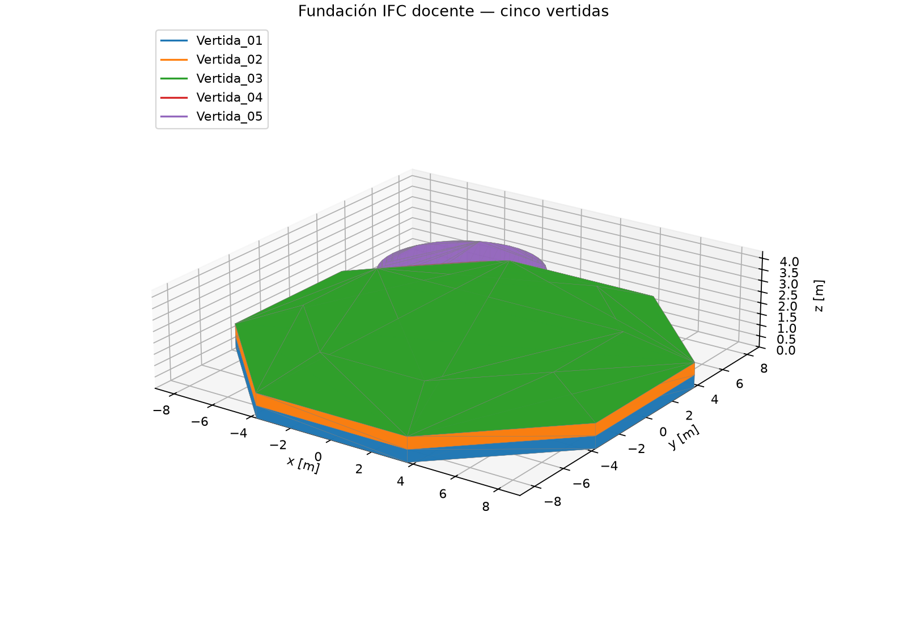
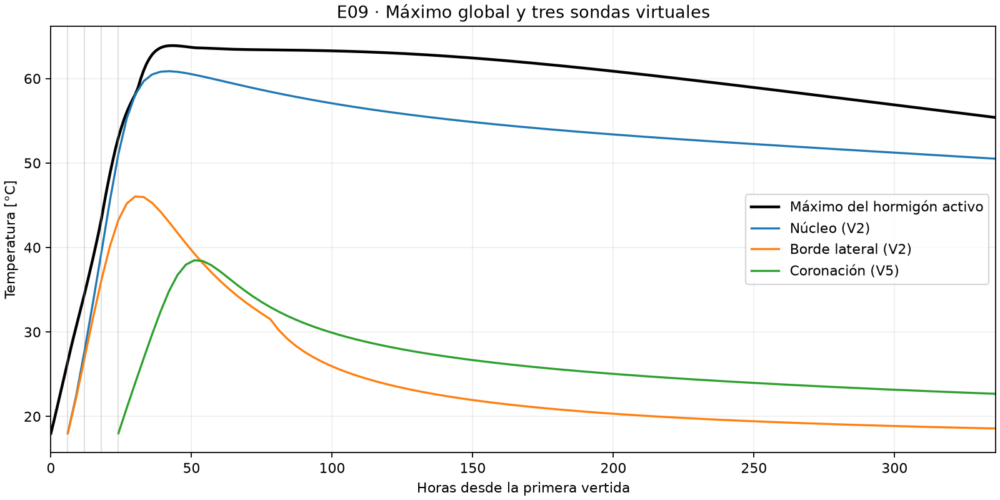
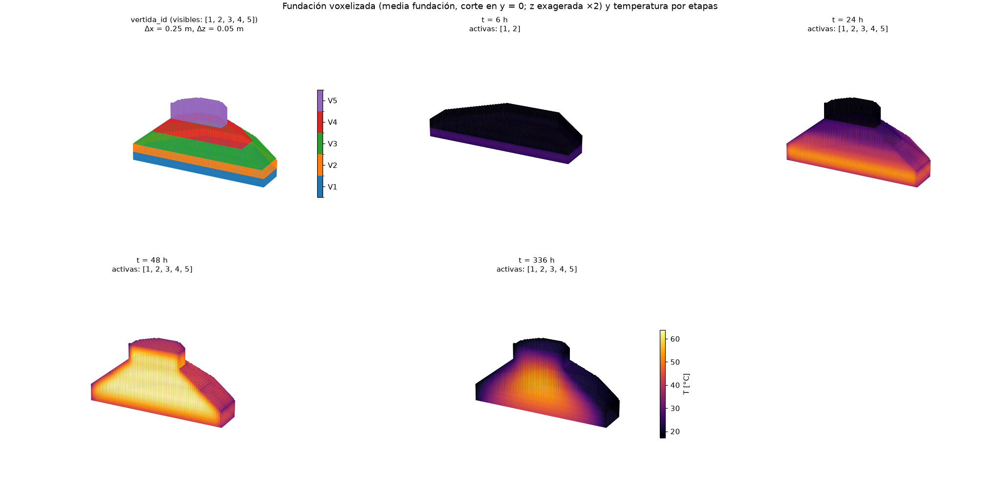

# E09 — Baseline 3D con hidratación

**Semana 3 · viernes 6 de noviembre de 2026**

Repositorio [magdalenafr-uandes/P02-MCOC](https://github.com/magdalenafr-uandes/P02-MCOC)

Commit evaluado [`541c61bc1bc5ac9213b4db169c848aae01a5efa6`](https://github.com/magdalenafr-uandes/P02-MCOC/commit/541c61bc1bc5ac9213b4db169c848aae01a5efa6)

## Geometría y vertidas

Se resolvieron 336 h de difusión térmica transitoria 3D en el IFC docente `geometry/foundation.ifc`, desde la primera colocación. El solver usa un balance de energía por voxel, conductancias entre vecinos con media armónica y Euler explícito con paso limitado por monotonía.



La voxelización asigna el centro de cada celda a un sólido IFC y conserva su identificador de vertida. El paso es **0,25 × 0,25 × 0,05 m**. La resolución vertical alinea las interfaces horizontales y se corrige el área de intercambio de las caras oblicuas escalonadas. El error se calcula como `|V_voxel − V_IFC| / V_IFC`, con el volumen IFC obtenido de la malla triangulada.

| Vertida | Inicio [h] | Retiro de moldaje [h] | IFC [m³] | Voxeles [m³] | Error |
| --- | ---: | ---: | ---: | ---: | ---: |
| V1 | 0 | 72 | 147,626 | 148,397 | 0,52 % |
| V2 | 6 | 78 | 147,626 | 148,397 | 0,52 % |
| V3 | 12 | 84 | 214,224 | 214,231 | < 0,01 % |
| V4 | 18 | 90 | 88,925 | 88,981 | 0,06 % |
| V5 | 24 | 96 | 38,375 | 38,188 | 0,49 % |
| **Total** | | | **636,775** | **638,194** | **0,22 %** |

Cada vertida se incorpora instantáneamente a **18 °C**, con edad equivalente cero, a partir del horario del IFC. Las anteriores conservan temperatura y madurez. Una interfaz cubierta por la siguiente vertida pasa de intercambio con aire a conducción entre hormigones, con contacto perfecto. Los retiros se cuentan 72 h después de cada colocación.

## Hidratación y bordes

El hormigón M1 usa `k = 2,22 W/(m·K)`, `ρ = 2400 kg/m³` y `cₚ = 970 J/(kg·K)`. La elevación adiabática es `θ(tₑ) = 45 K · [1 − exp(−tₑ/30 h)]`. Cada voxel activo genera `q = ρ cₚ dθ/dt`, con edad equivalente de Arrhenius (`Eₐ = 40 kJ/mol`, referencia de 20 °C). El calor adiabático asintótico es **104,76 MJ/m³**. La curva es un supuesto docente.

Se adopta aire constante a **16,6 °C** con `h = 10 W/(m²·K)`, sin radiación, viento variable ni ciclo diario. Las caras superiores expuestas están descubiertas. El moldaje lateral aporta `R = 0,12 m²·K/W` hasta el retiro. El suelo homogéneo de 3 m comienza a 16,6 °C, con la misma temperatura impuesta en su base y paredes laterales adiabáticas.

## Resultados

La grilla tiene 89 × 89 × 156 celdas y cero solapamientos. El máximo global fue **63,90 °C a las 43 h**, en V3, 31 h después de colocarla. El diferencial máximo dentro de una misma vertida fue **43,74 °C a las 145 h** en V3, entre la celda más caliente y el mínimo estimado a 25 mm de una cara expuesta. El pico queda bajo el umbral docente de 70 °C y el diferencial supera el de 20 °C. El balance contable cerró a la precisión reportada por el solver, con 67,73 GJ generados por hidratación y 31,03 GJ cedidos al ambiente.

| Sonda | Coordenadas (x, y, z) [m] | Pico [°C] | Hora del pico | T a 336 h [°C] |
| --- | --- | ---: | ---: | ---: |
| Núcleo V2 | (0 · 0 · 0,825) | 60,87 | 42 | 50,51 |
| Borde lateral V2 | (9 · 0 · 0,825) | 46,05 | 30 | 18,57 |
| Coronación V5 | (0 · 0 · 4,275) | 38,48 | 51 | 22,68 |



Las sondas corresponden a centros de voxel. El núcleo y el borde lateral están a la misma cota. La coronación se ubica en el eje del pedestal, a 25 mm de su cara superior. La serie del máximo global es horaria y las sondas se extraen de los campos cada 3 h. Las líneas verticales marcan el inicio de cada vertida. [Series numéricas](e09_temperaturas.csv).



El primer panel identifica las cinco vertidas voxelizadas. Los cortes térmicos comparten escala de color y muestran la media fundación, con exageración vertical ×2. A 6 h se acaba de incorporar V2 y a 24 h se acaba de incorporar V5. A 48 h se distingue un interior caliente rodeado por una franja más fría. A las 336 h el calor persiste principalmente bajo el pedestal.

## ¿Qué reproduce el modelo y qué falta?

**Reproduce** la acumulación de calor seguida de enfriamiento, con un núcleo más caliente y de enfriamiento más lento que las zonas expuestas. A igual cota y en la misma vertida, el borde alcanza su máximo 12 h antes que el núcleo. También aparece un gradiente vertical entre el núcleo y la coronación.

**Todavía falta reproducir** las magnitudes y los tiempos medidos. En la losa de 3,30 m estudiada, el núcleo llegó a unos 73 °C al cuarto día y un sensor próximo a la superficie alcanzó unos 67 °C al tercer día. La diferencia núcleo–superficie superior llegó a unos 35 °C al noveno día. Aquí el pico global llega antes y la coronación, que se coloca 18 h después de V2, alcanza su pico después de la sonda de núcleo en el reloj global, aunque a menor edad local (27 frente a 36 h). Los 43,74 °C corresponden a extremos de V3 y a una definición espacial distinta de la pareja de sensores del artículo. [Ju y Lei (2019), secciones 3 y 5](https://onlinelibrary.wiley.com/doi/full/10.1155/2019/7029671)

La geometría, las ubicaciones de las sondas y el régimen de exposición son distintos. El artículo ajusta la generación de calor con un ensayo adiabático y documenta medidas de aislamiento en obra. En E09 la cinética y el ambiente son supuestos, y la corrida única deja fuera la sensibilidad al espesor y la evaluación mecánica de fisuras.

## Reproducción

Desde la raíz del repositorio, con Python 3.10 o posterior:

```sh
cd proyecto
python -m pip install -e ".[dev]"
python scripts/preview_foundation.py --salida results/figures/e09_bim.png
python scripts/baseline_e09.py
python -m pytest
```

La corrida escribe las dos figuras térmicas, el CSV y el resumen en consola. La vista BIM usa el mismo IFC. Pasaron las 196 pruebas del proyecto. [Configuración E09](../configs/e09_baseline.yaml)
