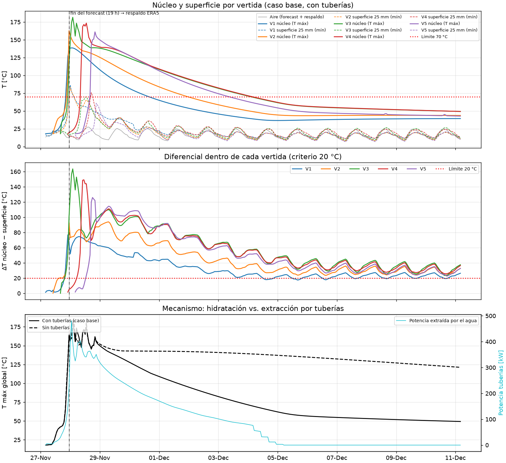
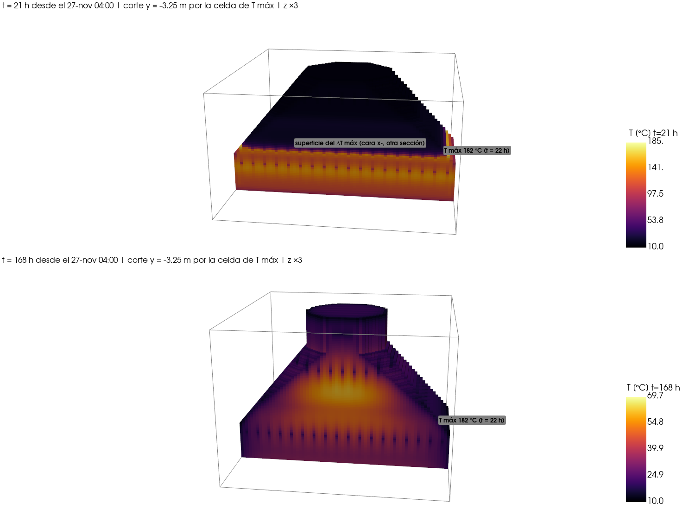

# E12 — Simulación determinista de 14 días

**Repositorio:** https://github.com/magdalenafr-uandes/P02-MCOC
**Commit evaluado:** el último commit de `main` que contiene este informe (`git rev-parse HEAD`).
Los resultados se generaron con el código del commit `b26c103c327dfbc971d6517a11425114ba1a35ef`, que queda registrado en
`docs/evidencia_e12/resumen.json`.

Reproducir (desde `proyecto/`, ~20 min):

```powershell
.venv\Scripts\python.exe scripts\e12_determinista.py
```

Usa `configs/e07_caso_base.yaml` sin sobrescrituras: el mismo YAML que el visor y la CLI.

## 1. Integración física

| Componente | Dato usado | Fuente |
|---|---|---|
| Geometría | `geometry/foundation.ifc`, 5 vertidas, 636,8 m³ voxelizados (error 0,22 %) | IFC (Bonsai) |
| Malla | Δx = Δy = 0,25 m, Δz = 0,05 m, 1 235 676 voxeles | convergida en E07/E08 |
| Hidratación | **una curva: `M2_22A`** del archivo `source_terms.txt` del profesor; θ∞ = 124,2 K; Arrhenius Eₐ = 40 kJ/mol, T_ref = 20 °C | `hormigones.M1.hidratacion` |
| Hormigón | k = 2,22 W/mK, ρ = 2400 kg/m³, c_p = 970 J/kgK | Ju y Lei (2019) |
| Suelo | 3 m explícitos, k = 1,39, ρ = 1800, c_p = 1273, T₀ = 16,6 °C | Ju y Lei (2019) / [SUPUESTO] |
| Moldaje/aislación | madera 18 mm (R = 0,12 m²K/W) hasta 72 h; sin aislación | catálogo `protecciones` |
| Tuberías | 1 capa por vertida, Ø 25 mm cada 1 m, agua a 15 °C los primeros 7 días (pared Dirichlet) | [SUPUESTO] |
| Clima | forecast + respaldo ERA5 (sección 2) | `clima` |

**Por qué `M2_22A`:** su θ total (124,2 K) es el más cercano a la media (123,9 K) y a la mediana (125,5 K)
de las 8 probetas, y su Q llega a ≈ 0 a las 72 h. Las curvas SS mantienen 35–76 W/m³ a los 7 días.

**Paso de tiempo.** dt = 0,8·C/ΣG, con dt ≤ 0,5 h y **≤ 1 K de θ liberado por voxel y paso**
(`simulacion.dtheta_max_paso_K`). Sin ese tope el pico dependía de dt: 196 → 172 °C. Con el tope converge:
181,9 / 181,8 / 182,0 °C con 2 / 1 / 0,5 K. El residuo del balance de energía es 2·10⁻¹⁵.

## 2. Clima: dataset, timestamp y horizonte

| | Forecast | Respaldo |
|---|---|---|
| Carpeta | `data/weather/2026-11-12T2259_pronostico` | `data/weather/2026-10-31T1807_historico` |
| Tipo | forecast determinista, Open-Meteo `best_match` | reanálisis ERA5 (Open-Meteo archive) |
| Descargado | **2026-11-12 22:59:41 UTC** | 2026-10-31 18:07:35 UTC |
| Cobertura de la obra | **19 h** (27-nov 04:00 → 23:00) | **317 h** restantes |
| SHA-256 (`forecast.json`) | `808e9928d1281f8fa603bb79836a436460eb5af0fdb60536134f396cdb33c5de` | `1905b88deaf74b3cf03058e5c6974233aa8e39f48004bc7ea3e3c049d0192871` |

Variables: `temperature_2m`, `wind_speed_10m` y `shortwave_radiation`, en el punto oficial del sitio
(−24,9528; −70,0048; `configs/site.yaml`), zona horaria America/Santiago.

**Horizonte no cubierto.** El forecast se descargó 14,2 días antes de la obra y solo alcanza hasta el
27-nov 23:00. La cola de 317 h se completa con `clima.completar: respaldo`, usando **el clima
observado de las mismas fechas de 2025** (ERA5 desplazado +1 año) como **análogo**. No es un pronóstico.
El pipeline declara cuántas horas vienen de cada fuente, y las curvas marcan el cambio con una línea vertical.
Antes del 27-nov se descargará un forecast nuevo (sin sobrescribir este) y se repetirá la corrida.

## 3. Condiciones de borde

| Superficie | Condición | Valores |
|---|---|---|
| Cara superior expuesta | Robin sol-aire: q = (T_eq − T)/[(Δ/2)/k + R + 1/(h_c+h_r)] | h_c = 2,8 + 3,0·v₂ₘ (Watmuff, v₂ₘ = 0,72·v₁₀); h_r = 4εσT³, ε = 0,9; α·G con α = 0,65; R = 0 |
| Caras laterales e inferiores al aire | Robin igual, sin sol (f = 0) | + moldaje R = 0,12 m²K/W hasta 72 h desde cada colocación; después R = 0 |
| Contacto hormigón–suelo y entre vertidas | conducción (media armónica de k) | suelo explícito de 3 m |
| Base de la caja (−3 m) | Dirichlet | 16,6 °C |
| Caras laterales de la caja (2 m de margen) | adiabáticas | — |
| Tuberías | Dirichlet en la pared, pozo en celda: P = 2πkL/ln(r_eq/r)·(T − T_agua) | T_agua = 15 °C, 0–168 h desde cada colocación |
| Hormigón aún no vertido | vacío a T del aire, sin conducción | — |

Criterio de superficie: T a 25 mm bajo la cara expuesta (`MAPA:superficie-25mm`).
ΔT se evalúa **dentro de cada vertida**: su núcleo contra su propia superficie.

## 4. Plan de vertidas

Inicio de obra: **27-nov-2026 04:00** (America/Santiago).

| Vertida | Volumen [m³] | Inicio | T colocación | Moldaje / retiro |
|---|---|---|---|---|
| 1 | 148,4 | 27-nov 04:00 (0 h) | 18 °C | madera 18 mm, retiro a 72 h |
| 2 | 148,4 | 27-nov 10:00 (6 h) | 18 °C | ídem |
| 3 | 214,2 | 27-nov 16:00 (12 h) | 18 °C | ídem |
| 4 | 89,0 | 27-nov 22:00 (18 h) | 18 °C | ídem |
| 5 | 38,2 | 28-nov 04:00 (24 h) | 18 °C | ídem |

Origen: inicio, T de colocación y retiro del moldaje vienen del pset del IFC; el moldaje, del YAML.
Las 5 vertidas usan el mismo hormigón M1.

## 5. Resultados

| Magnitud | Valor | Cuándo | Dónde | Criterio |
|---|---|---|---|---|
| **T_max** | **181,6 °C** | 22 h (28-nov 02:00) | vertida 3, borde exterior de su cara superior inclinada: (8,25; −3,25; 1,375) m, r = 8,9 m, celda a 25 mm bajo la cara | ≤ 70 °C: **no cumple** (−111,6 °C) |
| **ΔT_max** (dentro de la vertida) | **163,6 °C** | 22 h (28-nov 02:00) | vertida 3: núcleo = la celda de T_max (181,6 °C); superficie = cara lateral x− en (−3,0; −7,0; 1,825) m a 25 mm, 18,0 °C | ≤ 20 °C: **no cumple** (−143,6 °C) |

| Vertida | T_max [°C] (h) | ΔT_max [°C] (h) |
|---|---|---|
| 1 | 138,6 (21) | 76,8 (18) |
| 2 | 162,6 (19) | 94,0 (51) |
| 3 | 181,6 (22) | 163,6 (22) |
| 4 | 173,4 (33) | 149,2 (31) |
| 5 | 161,1 (40) | 126,0 (38) |

- T_max baja de 70 °C recién a las 167 h (4-dic). A los 14 días vale 49,3 °C, y ΔT sigue en 26–38 °C
  en todas las vertidas, oscilando con las noches (aire 7,6–27,3 °C).
- Energía en 14 días: hidratación 184,5 GJ; tuberías −108,9 GJ (59 %), ambiente −40,5 GJ, base −0,3 GJ.
- Sin tuberías (`tuberias=[]`): T_max = 183,2 °C y ΔT_max = 162,4 °C. El pico se forma antes de 24 h,
  cuando cada tubo enfría solo ~0,3 m a su alrededor (√(αt)). Las tuberías sí aceleran el enfriamiento:
  a los 14 días T_max es ~120 °C sin ellas y 49 °C con ellas.
- Incertidumbre: ±1 °C en T_max global y ±3 °C en los picos por vertida (Δθ = 2/1/0,5 K).



**Visualización 3D.** Corte vertical y = −3,25 m por la celda de T_max (PyVista, z ×3). **Arriba, 21 h:**
V1 y V2 a 120–150 °C y un frente de hidratación que sube por V3. V4, recién colocada, sigue fría. El pico
está en el borde exterior de V3, donde es delgada (0,3 m) y se apoya sobre V2 caliente. **Abajo, 168 h:**
el calor remanente queda en el núcleo de V3/V4 (≈ 70 °C). Las marcas cada 1 m son los cruces de los
tubos en dirección y (V2 y V4).



Serie 3D completa: `results/e12/vtk/temperatura.pvd` (ParaView, Threshold `material` 0,5–1,5) o el visor
E08, que usa el mismo YAML. Series horarias: `results/e12/series.csv`.

## 6. Conclusión

**El plan no cumple determinísticamente ninguno de los dos criterios**, y el margen es
grande: 112 °C en T_max y 144 °C en ΔT.

**Mecanismo que controla el resultado: el calor de hidratación de la curva medida.** θ∞ = 124 K
implica que incluso un bloque adiabático colocado a 18 °C llega a 142 °C, el doble del límite. Sobre ese
nivel actúan dos amplificadores, medidos en corridas de sensibilidad (Δx = 0,5 m, 72 h):

| Variante | T_max | ΔT_max |
|---|---|---|
| Caso base | 177 °C | 157 °C |
| Sin Arrhenius (Eₐ = 0) | 117 °C | 92 °C |
| Las 5 vertidas a la vez | 149 °C | 108 °C |
| Curva más baja (M4_22A, θ 82 K) | 113 °C | 87 °C |
| Curva pedagógica θ∞ = 45 K (E10) | 61 °C | 44 °C |

1. **Colocación escalonada cada 6 h.** Cada vertida se coloca sobre otra que ya está a 130–160 °C: se
   precalienta por conducción y después libera su propio θ∞. Suma ~30 °C frente a colocarlas a la vez (149 → 177 °C).
2. **Arrhenius.** A 150 °C el factor de edad equivalente es ~150. Una celda fría que recibe ese calor libera
   su curva en minutos, y el frente sube hasta la cara superior (pico en el borde de V3). Eₐ = 40 kJ/mol es un
   [SUPUESTO] válido cerca de 20 °C; usarlo sobre 100 °C es una extrapolación, así que el valor exacto de 182 °C
   no es confiable. La conclusión sí lo es: sin Arrhenius (117 °C) o con la probeta más baja (113 °C) tampoco cumple.

ΔT lo controla el contraste entre ese núcleo y una superficie que el aire nocturno del desierto y el
desmolde a 72 h dejan cerca de 10–20 °C. Ni siquiera con la curva pedagógica (θ∞ = 45 K) cumple ΔT, aunque
sí cumpliría T_max.

**Siguiente paso.** La curva medida implica 192–381 MJ/m³, cerca del doble de lo habitual (~120–200 MJ/m³:
300–400 kg/m³ de cemento × ~400 kJ/kg). Consultamos al profesor si Q(t) ya descuenta las pérdidas de la
probeta. Si el dato se confirma, hacen falta medidas de fondo: hormigón de menor calor, colocación más fría,
tuberías más densas y vertidas más espaciadas.
